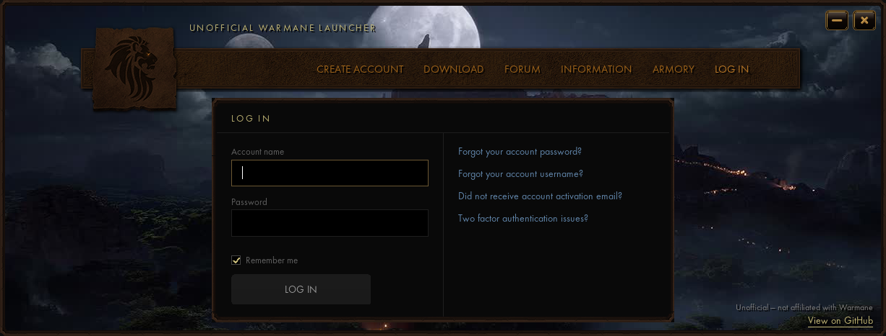
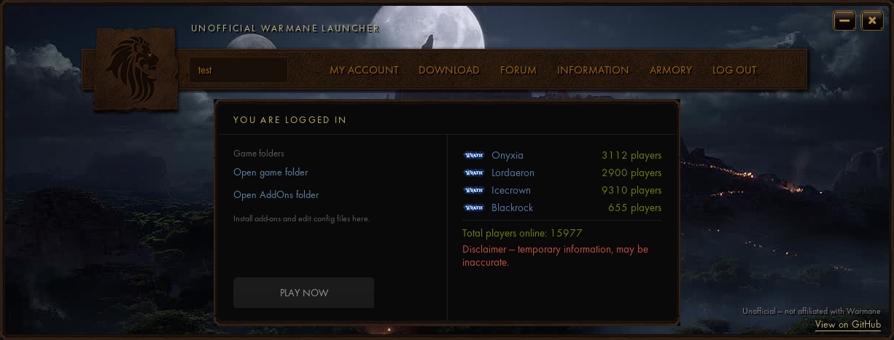

# Unofficial Warmane Launcher

A small, free launcher for the World of Warcraft **3.3.5a** client, made for players of the Warmane server.
It finds your game, fills in the game's own login screen for you, and starts `Wow.exe` with one click.
There is a **Windows** version and a native **Linux** version (made to work with [Faugus Launcher](https://github.com/Faugus/faugus-launcher)).

> **This is an unofficial community project. It is not affiliated with or endorsed by Warmane.**
> It does not connect to Warmane, patch the game or change any game data.

| Log in | Logged in |
| --- | --- |
|  |  |

## Download

Go to the [**Releases**](../../releases) page and download:

| System | File |
| --- | --- |
| Windows | `unofficial-warmane-launcher-setup.exe` (installer) |
| Linux | `Unofficial-Warmane-Launcher-x86_64.AppImage` |

## Install and use

### Windows
1. Run `unofficial-warmane-launcher-setup.exe`. It asks for administrator rights because the default folder is under Program Files.
2. The installer suggests your WoW 3.3.5a folder, `C:\Program Files (x86)\World of Warcraft 3.3.5a (no install)`. Use **Browse** to pick another folder. If there is no `Wow.exe` in the folder you pick, the installer warns you but lets you continue.
3. Start the launcher from the desktop or Start-menu shortcut.

Installing into the game folder is the easiest option, because the launcher then finds `Wow.exe` on its own.

### Linux
1. Download the AppImage, make it executable (`chmod +x Unofficial-Warmane-Launcher-x86_64.AppImage`) and run it.
2. If WoW is in your **Faugus** library, the launcher finds it and reuses that entry's prefix, Proton version and settings, so there is nothing to set up. Otherwise it asks you to point it at your `Wow.exe` once.
3. Requirements: GTK 4.10 or newer and glibc 2.38 or newer (any current Arch/CachyOS, Fedora or Ubuntu 24.04+). Faugus (or `umu-run`) is used to start the game.

You can also run the Windows version on Linux through Wine / Proton (for example as a Faugus entry); both versions look and behave the same.

## What the launcher does

- **Finds your game.** On start it looks for `Wow.exe` next to itself, then at the path it saved last time, then (Windows) at the default path above or (Linux) in your Faugus library. If it finds nothing, it asks you to point it at your `Wow.exe` once. It only accepts a file named `Wow.exe` and remembers your choice.
- **Prepares the login screen.** It copies four small files into the game's `Interface\GlueXML` folder (`AccountLogin.lua`, `AccountLogin.xml` and their `.origin` copies). They let the game's own login screen fill in your account name and password. Files that already exist are left alone.
- **Logs you in.** Type your account name and password and press **LOG IN**. The launcher writes them into `AccountLogin.xml`, so when the game starts its login screen is already filled in. Special characters in the password are handled safely.
- **Remembers your account name (optional).** With "Remember me" ticked it saves only the account name, never the password. On the next start it checks the name against the game file, and if they do not match you get the login screen again.
- **Starts the game.** **PLAY NOW** repairs any missing login files and starts `Wow.exe` from the game folder.
  - *Windows:* runs `Wow.exe` directly, and asks for administrator rights if the game needs them.
  - *Linux:* runs it the way Faugus does, with `umu-run`, the prefix and Proton version of your Faugus entry (see [How it works](docs/HOW-IT-WORKS.md)).
- **Opens your game folders.** When logged in, **Open game folder** opens the folder with `Wow.exe` and **Open AddOns folder** opens `Interface\AddOns` (created if missing). This is where you install add-ons and edit config files.
- **Logs out cleanly.** **LOG OUT** forgets the saved account name and blanks the account name and password in the game file.
- **Window extras.** A fixed-size borderless window you can drag, with minimize and close buttons, and a silent looping video background that pauses when the window is minimized and while the game is running. The menu links open in your normal web browser.

## What the launcher does not do

- It makes **no network connections of its own**. It does not contact Warmane, check your password, download or patch the game, or send any data anywhere.
- It does not read or change the game's memory or data files. It only touches `Interface\GlueXML` inside your game folder, and its own settings file.
- The realm player counts shown when you are logged in are **placeholder numbers**, not live data.

## Security note

While you are logged in, your account name **and password are stored in plain text** in
`Interface\GlueXML\AccountLogin.xml` inside your game folder. This is how the game's login-screen auto-fill works.

- Press **LOG OUT** when you are done, especially on a shared computer. It blanks both values.
- Do not share your game folder while you are logged in.
- Your password is never saved in the launcher's own settings.

## Files the launcher creates

| Where | What |
| --- | --- |
| `<game folder>\Interface\GlueXML\` | The four login-screen files described above. |
| Windows: `%APPDATA%\WarmaneLauncher\config.ini` | The path to `Wow.exe` and, if you chose "Remember me", your account name. |
| Linux: `~/.config/unofficial-warmane-launcher/config.ini` | The same settings. |

## Uninstall

- **Windows:** use "Apps / Installed apps", or the Start-menu uninstall shortcut. The uninstaller removes only the files the installer added (the launcher, the uninstaller, shortcuts and registry entries), never your game files, and asks whether to also delete the launcher's settings. The login files in `Interface\GlueXML` are left in place.
- **Linux:** delete the AppImage, and `~/.config/unofficial-warmane-launcher` if you want to remove its settings.

## Status

- **Windows:** tested under Wine 9 on Linux (finding the game, the locate box, login with special characters, "Remember me", log out, PLAY NOW, the video background, and the installer: default folder, custom folder and uninstall). Not yet tested on real Windows, so feedback is welcome.
- **Linux:** tested in a test environment with a stand-in for Faugus (game detection, login, PLAY NOW command, folder links, AppImage start). Not yet tested on a real Faugus installation. Please open an [issue](../../issues) with anything that goes wrong.

## Documentation

- [How it works](docs/HOW-IT-WORKS.md): the login-file technique, what each version reads and writes, and how the Linux version starts the game.
- [Building from source](docs/BUILDING.md): build both versions and run the tests.

## Repository layout

| Folder | Contents |
| --- | --- |
| `shared/` | Code and images used by both versions: login-file logic, images, font, video, tests. |
| `windows/` | The Windows program (Win32 + GDI+) and the NSIS installer. |
| `linux/` | The Linux program (GTK4 + Cairo + Pango) and the Faugus integration. |
| `docs/` | Documentation and screenshots. |

## Credits and disclaimer

The way the Linux version finds and starts games is based on how [Faugus Launcher](https://github.com/Faugus/faugus-launcher) (MIT license) stores its library and runs games. No Faugus code is copied.

World of Warcraft and Blizzard Entertainment are trademarks of Blizzard Entertainment, Inc.
Warmane and its logos belong to their respective owners. This project is made by a player for players, is provided as is, with no warranty, and use is at your own risk.
